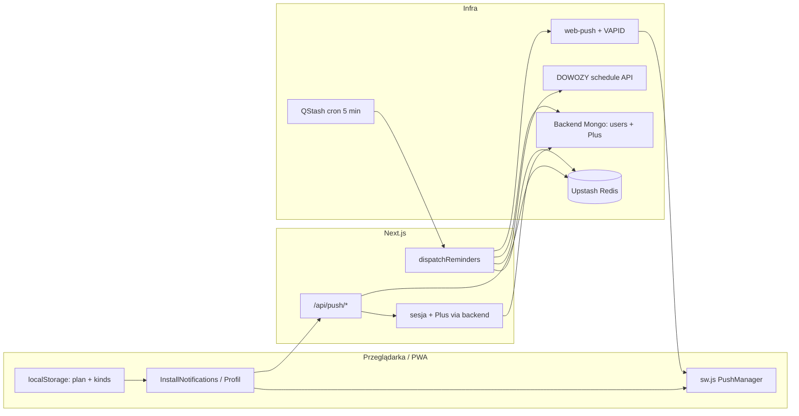

# Analiza powiadomień i migracja na Mongo

## Stan obecny — jak działa Web Push

Powiadomienia to **Web Push** (nie in-app inbox). Dostępne tylko przy **sesji + aktywnym Planie Plus** (`active` / admin; **nie** trial). UI dodatkowo za flagą `PUSH_NOTIFICATIONS_UI_ENABLED=true`.

### Architektura dziś



### Co jest zapisywane i gdzie

| Dane                                        | Gdzie                 | Klucz / kolekcja                         |
| ------------------------------------------- | --------------------- | ---------------------------------------- |
| Subskrypcja Push (endpoint + p256dh + auth) | Redis                 | `school-bus:push:{sha256(endpoint)}`     |
| Kopia planu lekcji dla przypomnień          | Redis (w rekordzie)   | pole `plan`                              |
| Rodzaje powiadomień                         | Redis + localStorage  | `kinds` / `school-bus.push-kinds.v1`     |
| Dedupe dzienny                              | Redis                 | `sentOn`, `sent[]`                       |
| Fingerprint rozkładu                        | Redis                 | `scheduleFingerprint`                    |
| Właściciel                                  | Redis                 | `userId`                                 |
| Index wszystkich urządzeń                   | Redis SET             | `school-bus:push:index`                  |
| Index po użytkowniku                        | Redis SET             | `school-bus:push:by-user:{userId}`       |
| Lock dispatch                               | Redis                 | `school-bus:push:lock` (NX, 60 s)        |
| Plan konta (do 5 dzieci)                    | **Mongo via backend** | `users.plans` — **osobny** od kopii push |
| Plus entitlement                            | **Mongo via backend** | billing API                              |

Źródło prawdy przy wysyłce to **kopia w Redis**, nie localStorage i nie `users.plans`. Sync: subscribe + `PUT /api/push/plan` / `kinds` + `syncStoredPushPlan` przy zapisie lekcji.

**Kształt `PushRecord`** ([`src/lib/push/store.ts`](src/lib/push/store.ts)):

```ts
{
  subscription: { endpoint, keys: { p256dh, auth } },
  plan: ChildLessonPlan,       // place + days 1–5
  sentOn: string,              // YYYY-MM-DD Warsaw
  sent: string[],              // trip ids już wysłane dziś
  scheduleFingerprint: string,
  kinds: { departure, return, schedule },
  userId?: string
}
```

Bez TTL na rekordach push (w przeciwieństwie do transferu QR 15 min).

### Endpointy i odpowiedzialności

| Endpoint                     | Auth                | Rola                                                  |
| ---------------------------- | ------------------- | ----------------------------------------------------- |
| `POST /api/push/subscribe`   | sesja + Plus active | zapis / update rekordu; confirmation push przy create |
| `DELETE /api/push/subscribe` | sesja (bez Plus)    | wypisanie                                             |
| `PUT /api/push/plan`         | Plus                | aktualizacja planu w rekordzie                        |
| `PUT /api/push/kinds`        | Plus                | aktualizacja kinds                                    |
| `POST /api/push/test`        | Plus + RL           | próbna notyfikacja                                    |
| `POST /api/push/dispatch`    | podpis QStash       | worker przypomnień                                    |

Klienta: [`src/lib/push/browser.ts`](src/lib/push/browser.ts), UI: [`install-notifications.tsx`](src/components/install-notifications.tsx) + sekcja w [`profile-panel.tsx`](src/components/profile-panel.tsx). SW: [`public/sw.js`](public/sw.js) — tylko `push` + `notificationclick`.

### Dispatch (wysyłka)

1. QStash: `*/5 6-16 * * 1-5` Europe/Warsaw → `POST /api/push/dispatch`
2. Early exit: weekend / poza 06–17 Warsaw / pusty index / lock zajęty / brak rozkładu
3. `loadScheduleSnapshot()` z `DOWOZY_API_BASE_URL`
4. Dla każdego rekordu:
   - brak `userId` lub Plus ≠ `active` → **usuń** rekord (`fetchPlusForUser`)
   - zmiana fingerprint → opcjonalny push „Rozkład zaktualizowany” (+ clear `sent`)
   - kursy w oknie **1–20 min** ([`due-trips.ts`](src/lib/push/due-trips.ts)) wg planu + kinds → `web-push`
   - endpoint 404/410 → usuń subskrypcję
5. `deletePushRecordsForUser` istnieje, ale **nie jest wołane** przy revoke — czyszczenie jest dopiero przy kolejnym dispatchu

### Co już jest na Mongo / backendzie

Auth, sesje, users (`plans`), Plan Plus, Stripe webhook — już przez BFF Next → Python ([`src/lib/auth/backend.ts`](src/lib/auth/backend.ts)). Push **nie** ma jeszcze `/api/v1/push/*`.

To jest ostatni duży kawałek „durable Redis” z planów [`.cursor/plans/redis_to_mongo_a0493646.plan.md`](.cursor/plans/redis_to_mongo_a0493646.plan.md) (Faza 4).

---

## Decyzje migracji (ustalone)

1. **Per-device kopia planu zostaje** na `push_subscriptions` (jak dziś) — nie łączymy z `users.plans` w pierwszym cutoverze (różne modele: 1 plan na urządzenie vs do 5 planów konta).
2. **Magazyn + dispatch + VAPID send** przenosimy do **Python/Mongo**.
3. **Redis zostaje** tylko na: dispatch lock, rate limity, transfer QR.
4. **Next** dla przeglądarki zostaje BFF (`/api/push/*` → backend); QStash celuje **bezpośrednio** w Python.
5. Rozkład w dispatchu: backend woła ten sam schedule API (`DOWOZY_API_BASE_URL`), nie czyta `data/*.json`.

---

## Plan przejścia

### Faza A — Backend: kolekcja + CRUD API

**Kolekcja `push_subscriptions`:**

- `_id` = `sha256(endpoint)` (hex, jak dziś)
- pola 1:1 z `PushRecord`
- index: `userId`
- brak TTL na dokumentach

**API (service key + opcjonalnie Bearer sesji jak reszta BFF):**

| Metoda   | Ścieżka                         | Zachowanie                                                              |
| -------- | ------------------------------- | ----------------------------------------------------------------------- |
| `POST`   | `/api/v1/push/subscribe`        | upsert; ownership (`auth` key + `userId`); Plus active; walidacja planu |
| `DELETE` | `/api/v1/push/subscribe`        | usunięcie po endpoint/auth + ownership                                  |
| `PUT`    | `/api/v1/push/plan`             | update `plan`                                                           |
| `PUT`    | `/api/v1/push/kinds`            | update `kinds`                                                          |
| `POST`   | `/api/v1/push/test`             | pywebpush próbka; RL może zostać w Next                                 |
| `POST`   | `/api/v1/push/dispatch`         | QStash verify → logika z [`dispatch.ts`](src/lib/push/dispatch.ts)      |
| `DELETE` | `/api/v1/push/by-user/{userId}` | bulk delete (service) — wołane przy revoke Plus                         |

Env w backendzie: `VAPID_*`, `QSTASH_*` signing keys, `DOWOZY_API_BASE_URL`, Upstash tylko pod lock (albo istniejący Redis klienta).

Port logiki 1:1: `due-trips` (lead 20 min), fingerprint, okno 06–17 Warsaw, weekday gate, confirmation payload, usuwanie przy `gone`.

### Faza B — Migracja danych Redis → Mongo

Skrypt one-shot (wzorzec [`scripts/migrate-users-to-backend.ts`](scripts/migrate-users-to-backend.ts)):

1. `SMEMBERS school-bus:push:index`
2. Dla każdego id: `GET school-bus:push:{id}` → `POST` / upsert do backendu
3. Zachować `userId`, `sent`, `sentOn`, `scheduleFingerprint`, `kinds`, `plan`
4. Dry-run + count; po cutoverze usunąć klucze push z Redis (zostawić lock key pattern jeśli używany)

### Faza C — Next → cienki BFF

W [`src/app/api/push/`](src/app/api/push/):

- `subscribe|plan|kinds|test` → `backendFetch('/api/v1/push/...')` (jak auth/billing)
- Rate limit subscribe/test **zostaje w Next** (Upstash)
- Bramka Plus: jak dziś (`requirePlusPush`) albo zaufanie backendowi — **zachować double-check w Next** dla spójności UX
- Usunąć trwałe użycie [`store.ts`](src/lib/push/store.ts) z route’ów (ew. zostawić tylko lock helper jeśli dispatch jeszcze lokalnie — docelowo nie)
- `send.ts` / VAPID private **wycofane z Next** po pełnym cutoverze (test też przez backend)
- `POST /api/push/dispatch` w Next: albo 410/redirect docs, albo krótki proxy na czas przejścia — **produkcyjny QStash URL zmienia się na Python**

Klient (`browser.ts`, UI, SW) **bez zmiany kontraktu URL** (`/api/push/...`) — tylko backend storage się zmienia.

### Faza D — Cutover operacyjny

1. Wdrożyć backend API + dispatch (shadow: cron na staging)
2. Zmigrować subskrypcje
3. Przełączyć QStash URL na `/api/v1/push/dispatch`
4. Przełączyć Next routes na proxy
5. Wyłączyć stary Next dispatch (nie przyjmować unsigned / stary schedule)
6. Podpiąć bulk delete przy revoke Plus w webhooku billingowym
7. Usunąć klucze `school-bus:push:*` (nie lock/rate/transfer) z Redis
8. Docs: [`.cursor/rules/pwa-and-push.mdc`](.cursor/rules/pwa-and-push.mdc), [`data-and-storage.mdc`](.cursor/rules/data-and-storage.mdc), polityka prywatności (Redis → Mongo)

### Faza E — Cleanup w tym repo

- Usunąć Redis CRUD z `store.ts` (lub zastąpić HTTP clientem); zostawić parsery `parseSubscription` / typy jeśli używane w BFF
- Zaktualizować testy: logika domenowa (`due-trips`, fingerprint, window) może zostać w TS do czasu portu testów w Python; route testy → mock `backendFetch`
- `.env.example`: VAPID private oznaczyć jako backend-only po cutoverze; Next może trzymać tylko public key

---

## Ryzyka i mitigacje

| Ryzyko                               | Mitigacja                                                              |
| ------------------------------------ | ---------------------------------------------------------------------- |
| Podwójny dispatch w trakcie cutoveru | Jeden aktywny URL w QStash; lock Redis współdzielony tym samym kluczem |
| Drift logiki due-trips TS vs Python  | Port + porównanie golden fixtures z istniejących `*.test.ts`           |
| Utrata subskrypcji przy migracji     | Dry-run counts; rollback = QStash z powrotem na Next + Redis dump      |
| Plus revoke bez bulk delete          | Dispatch i tak czyści; webhook delete to poprawa latency               |
| Plan konta ≠ plan push               | Świadomie bez unifikacji w v1; później osobna decyzja produktowa       |

---

## Zakres prac (podsumowanie)

**Backend (poza tym repo):** kolekcja, CRUD, pywebpush, dispatch, QStash verify, bulk delete on revoke, schedule fetch.

**To repo (Next):** BFF proxy, skrypt migracji, wycofanie Redis store/dispatch/send, aktualizacja reguł/polityki, testy pod HTTP.

**Bez zmian UX:** te same komunikaty, lead 20 min, kinds, iOS standalone, feature flag.
